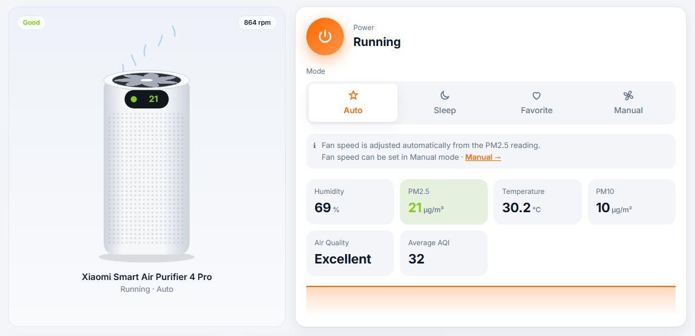

<div align="center">


# MiHome API

**A local web dashboard and REST API for Xiaomi Mi Home (MIoT) devices.**<br>
Sign in once, then see and control your devices from the browser or any script, over LAN or Xiaomi Cloud.

[](https://github.com/vitvu/MiHomeAPI/releases/latest)
[](#run-from-source)
[](LICENSE)

English · [Tiếng Việt](README.vi.md)



</div>

## Features

- **One-time login.** Sign in with your Xiaomi account, including captcha and two-step verification. The session is saved locally, and your password is never stored.
- **Animated device view.** The purifier's fan spins faster or slower with the real motor speed. Fans, humidifiers, lights, plugs and robot vacuums have their own illustrations.
- **Controls that match the device.** Power, mode and level controls are detected from the device's [MIoT spec](https://home.miot-spec.com). Fan speed only appears in Manual mode, the favorite level only in Favorite mode, and everything else is under **Advanced settings**.
- **LAN first, cloud fallback.** Commands go straight to the device on your network using [python-miio](https://github.com/rytilahti/python-miio), and through Xiaomi Cloud when LAN is not reachable.
- **REST API with built-in docs.** Every endpoint is listed in the UI with a ready-made `curl` command and a "Send request" button. Swagger is at `/docs`.
- **English and Vietnamese.** Switch with one click or with `?lang=vi`. Light/dark theme follows your system, and the layout works on phones.
- **No setup for Windows users.** Download one `.exe`, double-click it, and the browser opens.

## Quick start (Windows)

1. Download **`MiHomeAPI.exe`** from the [latest release](https://github.com/vitvu/MiHomeAPI/releases/latest).
2. Put it in its own folder and double-click it. Your browser opens at `http://127.0.0.1:8000`.
3. Sign in with your Mi Home account. Region detection is automatic.

Keep the console window open while you use the dashboard; closing it stops the server. Your session and device list are saved in a `data/` folder next to the exe. If Windows SmartScreen warns about an unknown publisher, click **More info → Run anyway**.

## Run from source

```bash
git clone https://github.com/vitvu/MiHomeAPI.git
cd MiHomeAPI
pip install -r requirements.txt
python app.py            # or: python app.py 8080
```

<details>
<summary><b>python-miio fails to install on Windows (<code>netifaces</code> needs C++ build tools)</b></summary>

Only LAN control needs python-miio; without it, everything works through the cloud. To install it without a compiler:

```bash
pip install netifaces-plus
pip install python-miio --no-deps
pip install "PyYAML>=5,<7" android_backup appdirs attrs "click>=8" "construct>=2.10.56,<3" croniter cryptography defusedxml pytz tqdm "zeroconf<1"
pip install micloud --no-deps
```
</details>

| Environment variable | Purpose |
|---|---|
| `PORT` | Port to listen on (default `8000`; the next free port is used if it is taken) |
| `MIHOME_NO_BROWSER=1` | Don't open the browser on start |

## REST API

Every control endpoint accepts `?via=auto|lan|cloud` (default `auto`). Properties can be addressed by **key** (`service.property`, e.g. `air-purifier.mode`) or by `siid`/`piid`. The **API** tab lists the keys for each of your devices.

| Method | Endpoint | Description |
|---|---|---|
| `POST` | `/api/login` | Sign in: `{username, password, server: "auto"}` (add `captcha` if asked) |
| `GET` | `/api/login/captcha` | Captcha image, when login asks for one |
| `GET` | `/api/session` | Login status |
| `POST` | `/api/logout` | Delete the saved session |
| `GET` | `/api/devices?refresh=true` | Devices with IP, token and online state |
| `GET` | `/api/devices/{did}/spec` | Properties and actions of the model |
| `GET` | `/api/devices/{did}/status` | Read every readable property |
| `GET` | `/api/devices/{did}/prop/{key}` | Read one property |
| `POST` | `/api/devices/{did}/props` | Write one or more properties |
| `POST` | `/api/devices/{did}/action` | Run an action |
| `POST` | `/api/devices/{did}/raw` | Send a raw miIO command over LAN |

```bash
# Read PM2.5
curl http://127.0.0.1:8000/api/devices/<did>/prop/environment.pm2.5-density

# Manual mode, fan level 2
curl -X POST http://127.0.0.1:8000/api/devices/<did>/props \
  -H "Content-Type: application/json" \
  -d '{"props":[{"key":"air-purifier.mode","value":3},{"key":"air-purifier.fan-level","value":2}]}'

# Reset the filter after replacing it
curl -X POST http://127.0.0.1:8000/api/devices/<did>/action \
  -H "Content-Type: application/json" -d '{"key":"filter.reset-filter-life"}'
```

Errors are returned as `{"error": "<code>", "message": "<text>"}`, for example `session_expired` or `lan_failed`.

## How it works

```
Browser / scripts ──HTTP──▶ MiHome API (FastAPI, 127.0.0.1)
                               ├── LAN  ──miIO (UDP 54321)──▶ device      (python-miio)
                               ├── Cloud ──signed HTTPS────▶ api.io.mi.com
                               └── Specs ──────────────────▶ miot-spec.org (cached)
```

1. **Login** follows the Mi Home app flow and stores `serviceToken` + `ssecurity` in `data/session.json`.
2. **Device list** comes from Xiaomi Cloud and includes each device's local IP and token.
3. **Specs** for each model are downloaded from miot-spec.org and cached in `data/spec_cache/`, which is why any MIoT device works without per-model code.

## Supported devices

Any device that exposes a MIoT spec: air purifiers, fans, humidifiers, lights, plugs, vacuums, sensors and more. Air purifiers have the most complete dashboard. It has been tested with the **Xiaomi Smart Air Purifier 4 Pro** (`zhimi.airp.vb4`). If your device doesn't look right, please [open an issue](https://github.com/vitvu/MiHomeAPI/issues) with its model name.

## Security

- The server listens on `127.0.0.1` only. Do not expose it to the internet: anyone who can reach it can control your devices.
- `data/` contains your session and device tokens. Keep it private; it is already in `.gitignore`.

## Build the exe

```bash
pip install -r requirements.txt pyinstaller
python build.py          # -> dist/MiHomeAPI.exe
```

Pushing a tag like `v1.0.0` builds the exe on GitHub Actions and attaches it to the release.

## Credits

- [rytilahti/python-miio](https://github.com/rytilahti/python-miio): miIO / MIoT LAN protocol
- [PiotrMachowski/Xiaomi-cloud-tokens-extractor](https://github.com/PiotrMachowski/Xiaomi-cloud-tokens-extractor): Xiaomi Cloud login flow
- [al-one/hass-xiaomi-miot](https://github.com/al-one/hass-xiaomi-miot) and [miot-spec.org](https://home.miot-spec.com): MIoT specs

## Disclaimer

This is an unofficial project and is not affiliated with or endorsed by Xiaomi. Use at your own risk.

## License

[MIT](LICENSE)
