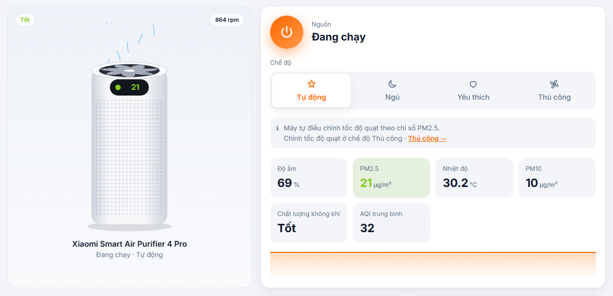

<div align="center">


# MiHome API

**Bảng điều khiển web chạy trên máy và REST API cho thiết bị Xiaomi Mi Home (MIoT).**<br>
Đăng nhập một lần, sau đó xem và điều khiển thiết bị từ trình duyệt hoặc script, qua mạng LAN hoặc Xiaomi Cloud.

[English](README.md) · Tiếng Việt



</div>

## Tính năng

- **Đăng nhập một lần.** Hỗ trợ cả captcha và xác minh 2 bước. Session được lưu trên máy, mật khẩu không bao giờ được lưu.
- **Hình thiết bị động.** Quạt của máy lọc quay nhanh hay chậm theo tốc độ motor thật. Quạt, máy tạo ẩm, đèn, ổ cắm và robot hút bụi đều có hình riêng.
- **Điều khiển theo đúng thiết bị.** Nút nguồn, chế độ và mức được tự nhận diện từ [MIoT spec](https://home.miot-spec.com) của thiết bị. Tốc độ quạt chỉ hiện ở chế độ Thủ công, mức yêu thích chỉ hiện ở chế độ Yêu thích, phần còn lại nằm trong **Cài đặt nâng cao**.
- **Ưu tiên LAN, dự phòng Cloud.** Lệnh gửi thẳng tới thiết bị trong mạng nhà bằng [python-miio](https://github.com/rytilahti/python-miio), không tới được thì đi qua Xiaomi Cloud.
- **REST API có sẵn tài liệu.** Mỗi endpoint đều có lệnh `curl` mẫu và nút "Gửi request" ngay trên giao diện. Swagger ở `/docs`.
- **Tiếng Anh và tiếng Việt.** Đổi bằng một cú bấm hoặc thêm `?lang=vi` vào link. Giao diện sáng/tối theo hệ thống và dùng được trên điện thoại.
- **Người dùng Windows không cần cài gì.** Tải một file `.exe`, bấm đúp là trình duyệt tự mở.

## Dùng nhanh (Windows)

1. Tải **`MiHomeAPI.exe`** ở [bản phát hành mới nhất](https://github.com/vitvu/MiHomeAPI/releases/latest).
2. Đặt vào một thư mục riêng rồi bấm đúp. Trình duyệt sẽ mở `http://127.0.0.1:8000`.
3. Đăng nhập bằng tài khoản Mi Home. Vùng máy chủ được tự dò.

Để cửa sổ console mở trong lúc dùng; tắt cửa sổ đó là tắt server. Session và danh sách thiết bị được lưu trong thư mục `data/` cạnh file exe. Nếu Windows SmartScreen cảnh báo, bấm **More info → Run anyway**.

## Chạy từ source

```bash
git clone https://github.com/vitvu/MiHomeAPI.git
cd MiHomeAPI
pip install -r requirements.txt
python app.py            # hoặc: python app.py 8080
```

Nếu cài `python-miio` bị lỗi `netifaces` trên Windows, xem hướng dẫn trong [README tiếng Anh](README.md#run-from-source). Thiếu thư viện này thì vẫn điều khiển được qua Cloud.

## REST API

Các endpoint điều khiển nhận `?via=auto|lan|cloud` (mặc định `auto`). Thuộc tính được gọi theo **key** (`service.property`, ví dụ `air-purifier.mode`) hoặc theo `siid`/`piid`. Tab **API** trong giao diện liệt kê key của từng thiết bị.

```bash
# Đọc PM2.5
curl http://127.0.0.1:8000/api/devices/<did>/prop/environment.pm2.5-density

# Chế độ Thủ công, quạt mức 2
curl -X POST http://127.0.0.1:8000/api/devices/<did>/props \
  -H "Content-Type: application/json" \
  -d '{"props":[{"key":"air-purifier.mode","value":3},{"key":"air-purifier.fan-level","value":2}]}'
```

Danh sách đầy đủ các endpoint có trong [README tiếng Anh](README.md#rest-api).

## Bảo mật

- Server chỉ nghe trên `127.0.0.1`. Không mở ra Internet: ai truy cập được cũng điều khiển được thiết bị của bạn.
- Thư mục `data/` chứa session và token thiết bị, đừng chia sẻ (đã có trong `.gitignore`).

## Lưu ý

Dự án không chính thức, không liên kết hay được Xiaomi xác nhận. Tự chịu rủi ro khi sử dụng.

## Giấy phép

[MIT](LICENSE)
